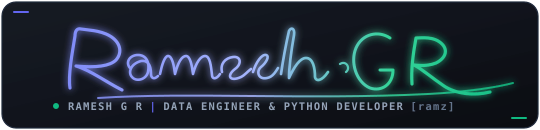

<div align="center">

  <!-- Cyberpunk Animated Header Banner -->
  <a href="https://ramesh13.online">
    
  </a>

  <br />

  <!-- Animated Typing Headline -->
  <a href="https://ramesh13.online">
    
  </a>

  <p align="center">
    <strong>Budding Data Engineer &amp; Python Developer | M.Tech in Software Engineering</strong><br />
    <em>"Bridging raw data with actionable intelligence — crafting scalable ETL pipelines, database optimizations &amp; BI dashboards."</em>
  </p>

  <!-- Glowing Action & Social Badges -->
  <p align="center">
    <a href="https://ramesh13.online" target="_blank">
      
    </a>
    <a href="https://www.linkedin.com/in/ramesh-radhakrishnan-a1517a19a/" target="_blank">
      
    </a>
    <a href="https://drive.google.com/file/d/1JvWT49gFLIWxs67gSm-7QlFii-XSxmKa/view?usp=sharing" target="_blank">
      
    </a>
    <a href="mailto:grrameshyamini13@gmail.com">
      
    </a>
    <a href="https://github.com/sponsors/ramesh9686" target="_blank">
      
    </a>
    <a href="https://www.instagram.com/dynamo._13/" target="_blank">
      
    </a>
  </p>

</div>


## 🛰️ Current Mission &amp; Engineering Focus

- 💼 **Current Focus:** Working on advanced predictive models, automated ETL data pipelines, and BI analytics dashboards at **AVG Graphics**.
- 🌱 **Learning &amp; Upskilling:** Modern Cloud Data Stack, Distributed Data Pipelines (**Apache Spark**, **Kafka**), and **AWS Cloud Architecture** / Serverless DevOps.
- 🤝 **Looking to Collaborate on:** High-impact Data Engineering solutions, scalable analytics infrastructure, and data-driven systems.
- 🎓 **Background &amp; Credentials:** **M.Tech in Software Engineering** | Data Engineer &amp; Python Developer (`ramesh13` / `ramz`).


## 🛠️ Tech Stack &amp; Architectural Toolkit

### ⚡ Languages &amp; Query Engines
<p align="left">
  
  
  
  
  
  
  
  
  
</p>

### ⚙️ Frameworks, Machine Learning &amp; WebGL
<p align="left">
  
  
  
  
  
  
  
  
  
</p>

### 🗄️ Databases, Cloud Infrastructure &amp; Pipelines
<p align="left">
  
  
  
  
  
  
  
</p>

### 🧰 Analytics Platforms, Tooling &amp; Environments
<p align="left">
  
  
  
  
  
  
  
  
  
  
</p>


## 📈 GitHub Activity &amp; Telemetry Stats

<div align="center">
  <table border="0" cellspacing="0" cellpadding="0">
    <tr valign="top">
      <td width="50%" align="center">
        <!-- Overall Stats Card -->
        <a href="https://github.com/ramesh9686">
          
        </a>
      </td>
      <td width="50%" align="center">
        <!-- GitHub Streak Stats Card -->
        <a href="https://github.com/ramesh9686">
          
        </a>
      </td>
    </tr>
    <tr valign="top">
      <td width="50%" align="center">
        <!-- Top Languages Card -->
        <a href="https://github.com/ramesh9686">
          
        </a>
      </td>
      <td width="50%" align="center">
        <!-- WakaTime Weekly Coding Activity Card -->
        <a href="https://wakatime.com/@ramesh9686">
          
        </a>
      </td>
    </tr>
  </table>
</div>

<br />

<!-- WakaTime Automated Section -->
<details open>
  <summary><strong>⏱️ Weekly Development Track (WakaTime Telemetry)</strong></summary>
  <br />

<!--START_SECTION:waka-->


**🐱 My GitHub Data** 

> 📦 ? Used in GitHub's Storage 
 > 
> 🏆 132 Contributions in the Year 2026
 > 
> 🚫 Not Opted to Hire
 > 
> 📜 18 Public Repositories 
 > 
> 🔑 0 Private Repositories 
 > 
**I'm an Early 🐤** 

```text
🌞 Morning                19 commits          ████░░░░░░░░░░░░░░░░░░░░░   14.29 % 
🌆 Daytime                78 commits          ███████████████░░░░░░░░░░   58.65 % 
🌃 Evening                36 commits          ███████░░░░░░░░░░░░░░░░░░   27.07 % 
🌙 Night                  0 commits           ░░░░░░░░░░░░░░░░░░░░░░░░░   00.00 % 
```
📅 **I'm Most Productive on Friday** 

```text
Monday                   10 commits          ██░░░░░░░░░░░░░░░░░░░░░░░   07.52 % 
Tuesday                  23 commits          ████░░░░░░░░░░░░░░░░░░░░░   17.29 % 
Wednesday                13 commits          ██░░░░░░░░░░░░░░░░░░░░░░░   09.77 % 
Thursday                 24 commits          █████░░░░░░░░░░░░░░░░░░░░   18.05 % 
Friday                   29 commits          █████░░░░░░░░░░░░░░░░░░░░   21.80 % 
Saturday                 29 commits          █████░░░░░░░░░░░░░░░░░░░░   21.80 % 
Sunday                   5 commits           █░░░░░░░░░░░░░░░░░░░░░░░░   03.76 % 
```


📊 **This Week I Spent My Time On** 

```text
🕑︎ Time Zone: Asia/Kolkata

💬 Programming Languages: 
Python                   24 mins             █████████████████░░░░░░░░   67.50 % 
TypeScript               6 mins              █████░░░░░░░░░░░░░░░░░░░░   18.99 % 
Other                    2 mins              ██░░░░░░░░░░░░░░░░░░░░░░░   07.09 % 
JSON                     2 mins              ██░░░░░░░░░░░░░░░░░░░░░░░   06.13 % 
HTML                     0 secs              ░░░░░░░░░░░░░░░░░░░░░░░░░   00.29 % 

🔥 Editors: 
Antigravity IDE          36 mins             █████████████████████████   100.00 % 

🐱‍💻 Projects: 
HRM                      12 mins             ████████░░░░░░░░░░░░░░░░░   33.05 % 
Unknown Project          7 mins              █████░░░░░░░░░░░░░░░░░░░░   21.37 % 
World-Explorer           7 mins              █████░░░░░░░░░░░░░░░░░░░░   20.33 % 
SMDM                     3 mins              ███░░░░░░░░░░░░░░░░░░░░░░   10.20 % 
FM                       2 mins              ██░░░░░░░░░░░░░░░░░░░░░░░   07.82 % 
```

🤖 **AI Coding This Week** 

```text
⏱ AI Coding Time: 36 mins (99.91%)

✍️ 1,589 lines written by AI, 1 lines written by hand (99.94% AI-written)

🔤 430,703 Input Tokens, 81,161 Output Tokens

💵 $1.84 Estimated AI Cost This Week

🧠 6 AI Sessions, 8 AI Prompts

Gemini                   1,589 lines         █████████████████████████   100.00 % 

🔎 AI Coding Insights:
🤖 AI-Driven — 99.94% of written lines came from AI
📄 Detailed Prompter — average 770 characters per prompt
🎯 One-Shot Prompter — average 1 prompts per session
🚀 High AI Trust — 0.06% of changed lines were hand-edited
```

**Timeline**


 Last Updated on 30/10/2026 03:53:56 UTC
<!--END_SECTION:waka-->

</details>


## 🤝 Let's Connect &amp; Collaborate

Whether you want to discuss distributed data pipelines, cloud architecture, predictive intelligence, or exciting engineering opportunities — my inbox and calendar are always open!

<div align="center">

  <!-- Animated Calligraphy Signature Banner -->
  <a href="https://ramesh13.online">
    
  </a>

  <br /><br />

  <p>
    <a href="mailto:grrameshyamini13@gmail.com">
      
    </a>
    &nbsp;
    <a href="https://www.linkedin.com/in/ramesh-radhakrishnan-a1517a19a/">
      
    </a>
    &nbsp;
    <a href="https://ramesh13.online">
      
    </a>
  </p>

  <sub>Designed with ⚡ by <a href="https://github.com/ramesh9686">Ramesh G R (@ramesh9686)</a> • Bangalore, India</sub>

</div>
